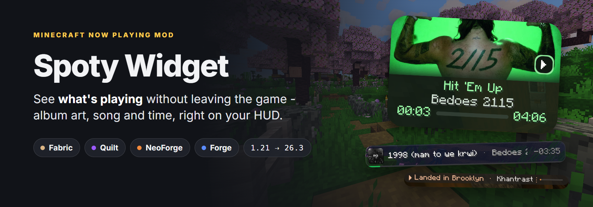
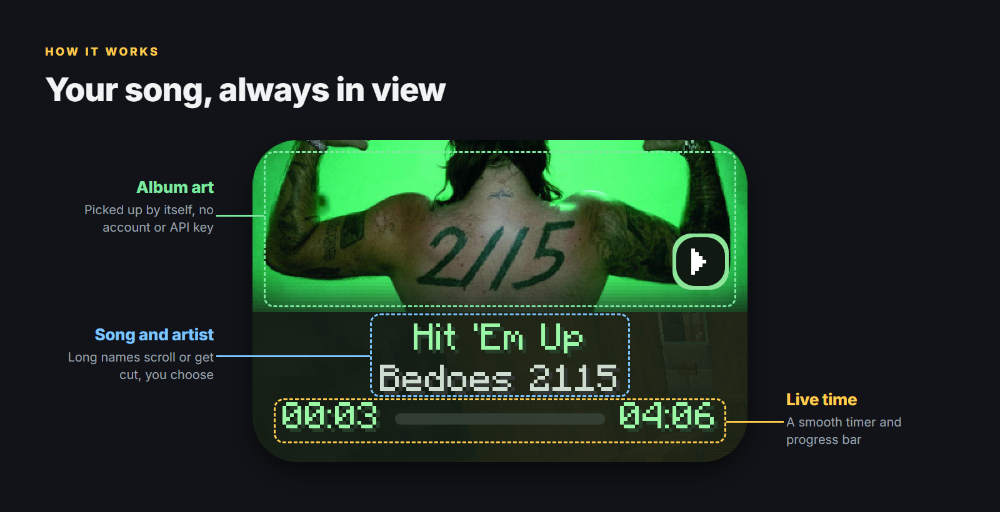
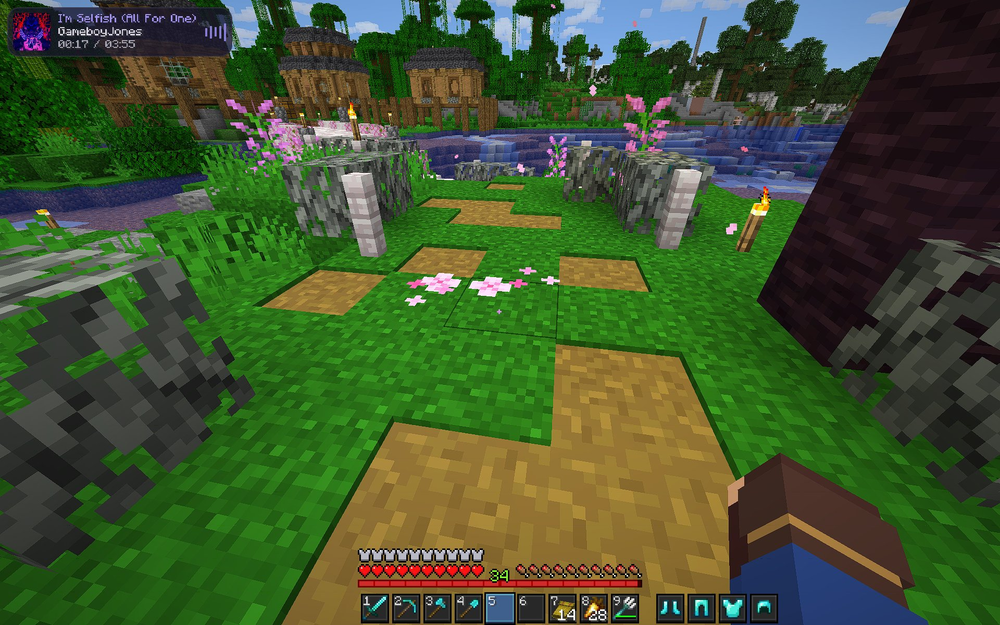
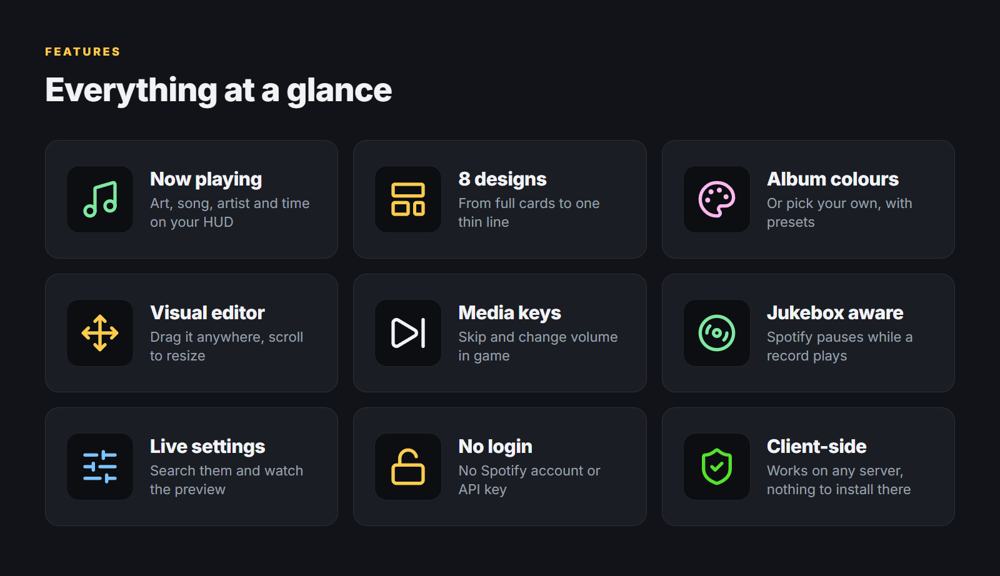
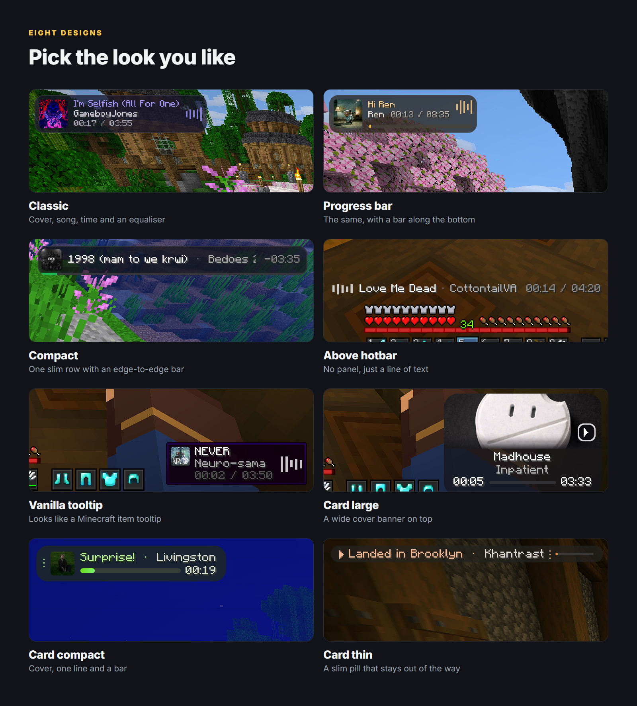
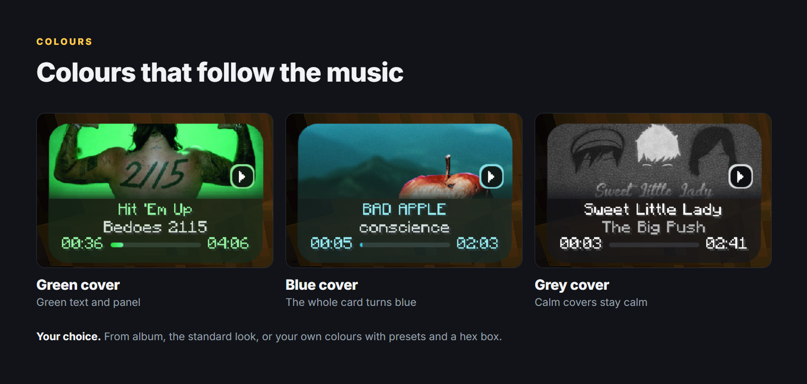
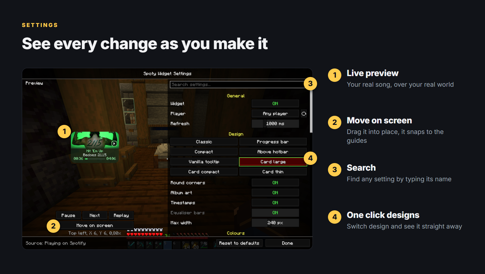
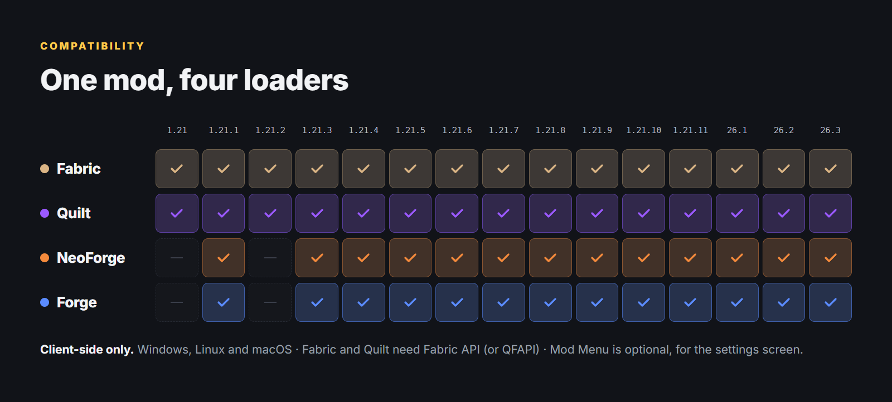

**See what's playing without leaving the game.** Spoty Widget puts your song in a corner of the screen: album art, title, artist and time, in one of eight designs.

**No Spotify account. No API key. No login.** It reads what the Spotify desktop app already tells your system.

## Setup
- **Fabric / Quilt** - needs [Fabric API](https://modrinth.com/mod/fabric-api) ([QFAPI](https://modrinth.com/mod/qsl) on Quilt); settings via [Mod Menu](https://modrinth.com/mod/modmenu) (optional)
- **NeoForge / Forge** - settings via *Mods → Spoty Widget → Config*
- **Move on screen** in the settings - drag the widget, scroll to resize, arrow keys to nudge
- **Arrow keys** in game - next and previous track, volume up and down; change them in *Options → Controls → Spoty Widget*
- Client-side only - join any server

## Good to know
- **Windows, Linux and macOS.** On macOS, allow Minecraft to control Spotify when asked (*System Settings → Privacy & Security → Automation*).
- The Spotify desktop app must be running. Set Player to *Any player* to also show browsers, VLC and more.
- Album art is looked up by artist and title on Deezer or iTunes. On Linux and macOS, Spotify provides the cover directly.

**Jar suffix:** `+1.21.1` `+1.21.3` `+1.21.4` `+1.21.5` `+1.21.8` `+1.21.10` `+1.21.11` `+26.1.2` `+26.2` `+26.3`

Also available on [Modrinth](https://modrinth.com/mod/spoty-widget). Source code on [GitHub](https://github.com/Kart-Modding/SpotifyMusicMod).

Suggestions or problems? Open an [issue](https://github.com/Kart-Modding/SpotifyMusicMod/issues) or visit [my links](https://link.karton.dev/).
