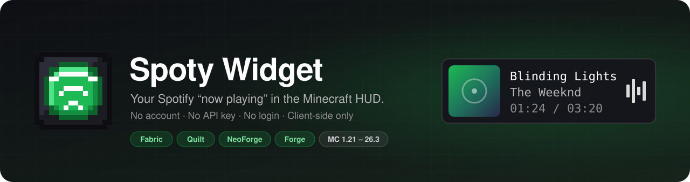
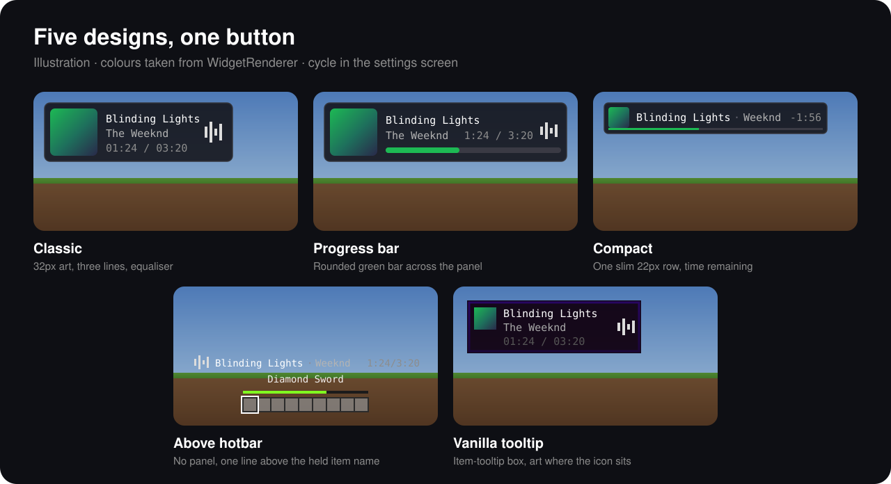
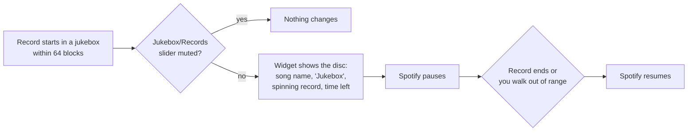
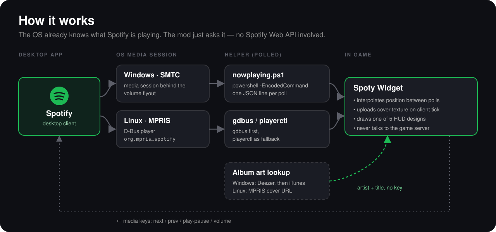

<div align="center">



[](https://github.com/Kart-Modding/SpotifyMusicMod/actions/workflows/build.yml)
[](https://modrinth.com/mod/pjhN6TWN)
[](https://www.curseforge.com/minecraft/mc-mods/spoty-widget)


[](LICENSE)

**[Features](#features) · [Install](#install) · [Designs](#designs) · [Settings](#settings) · [Controls](#playback-controls) · [How it works](#how-it-works) · [Building](#building)**

</div>

Spoty Widget is a client-side mod for **Fabric, Quilt, NeoForge and Forge** by **Kartonek**. It shows the song
you are playing in a corner of the screen (top left by default): album art, title, artist,
elapsed/total time and a small animated equaliser. You no longer need to alt-tab to check the song.

> [!NOTE]
> **You do not need a Spotify account, API key or login.** The mod reads the "now playing" information that
> the operating system already gets from the Spotify desktop app.

## Features

|   |   |
|---|---|
| 🎵 **Now playing in the HUD** | Album art, title, artist, a smooth timer and an equaliser |
| 🎨 **5 designs** | Classic, Progress bar, Compact, Above hotbar, Vanilla tooltip |
| ⌨️ **Media keys in game** | Next/previous track and volume up/down, on the arrow keys by default |
| 💿 **Jukebox aware** | A record that plays nearby takes over the widget and pauses Spotify |
| 🔒 **Private** | Client only. It never talks to the server you play on |
| 🧩 **Every loader** | Fabric, Quilt, NeoForge and Forge, Minecraft 1.21 to 26.3, all from one codebase |

## Install

1. Download the jar for your loader and game version from [Modrinth](https://modrinth.com/mod/pjhN6TWN),
   [CurseForge](https://www.curseforge.com/minecraft/mc-mods/spoty-widget) or
   [GitHub Actions](https://github.com/Kart-Modding/SpotifyMusicMod/actions/workflows/build.yml).
2. Put it in your `mods/` folder.
3. Start Spotify and play something.
4. Launch the game. The widget appears in the top left corner.

That is all the setup.

### Requirements

| Loader | Needs |
|---|---|
| **Fabric** | Fabric Loader 0.17+ and Fabric API. Mod Menu is optional (it gives you the settings screen) |
| **Quilt** | Quilt Loader with Fabric API (or QFAPI). Use the `-fabric` jar |
| **NeoForge** | NeoForge for that version. Settings: Mods → Spoty Widget → Config |
| **Forge** | Forge for that version. Settings: Mods → Spoty Widget → Config |

| OS | Status | Source |
|---|---|---|
| **Windows** | ✅ Supported | Media session behind the volume flyout (SMTC), read by a bundled PowerShell helper |
| **Linux** | ✅ Supported | MPRIS player on D-Bus (`org.mpris.MediaPlayer2.spotify`), read by `gdbus`, with `playerctl` as a fallback |
| **macOS** | ❌ Not supported | |

### Which jar do I need?

Each row ships as `-fabric`, `-neoforge` and `-forge` jars, named
`spotifywidget-<loader>-1.1.0+<version>.jar`. Quilt uses the Fabric jar.

| Jar suffix | Minecraft versions |
|---|---|
| `+1.21.1` | 1.21, 1.21.1 |
| `+1.21.3` | 1.21.2, 1.21.3 |
| `+1.21.4` | 1.21.4 |
| `+1.21.5` | 1.21.5 |
| `+1.21.8` | 1.21.6, 1.21.7, 1.21.8 |
| `+1.21.10` | 1.21.9, 1.21.10 |
| `+1.21.11` | 1.21.11 |
| `+26.1.2` | 26.1, 26.1.1, 26.1.2 |
| `+26.2` | 26.2 |
| `+26.3` | 26.3 |

## Designs



- **Classic**: 32px album art, title, artist, `00:15 / 03:45` and the animated equaliser.
- **Progress bar**: the same art and two lines of text. Elapsed/total moves to the right of the artist
  line, and a rounded green progress bar runs across the bottom of the panel.
- **Compact**: one slim 22px row. It has 16px art, then `Title · Artist`, the remaining time (`-1:23`)
  right-aligned, and a 2px progress line along the bottom edge. The title dims while paused.
  Use it with the 0.5x scale.
- **Above hotbar**: no panel, only a centred line of text: `Title · Artist   00:15 / 03:45`. When enabled, the
  equaliser is on its left. The line is one line above the vanilla held item name, which is above the
  experience bar, so the two never overlap. This design ignores Corner. Offset Y moves the line higher.
- **Vanilla tooltip**: looks like an item tooltip. It uses the game's `0xF0100010` box, purple gradient
  border and white/grey/dark-grey text colours, with the album art where an item icon goes.
  It ignores Background opacity, so it matches vanilla exactly.

### When the widget shows

With **Always on**, the widget is visible whenever something is playing. With **15 seconds** or **5 seconds**,
it shows for that long when a track starts and again before it ends. The two "Show at" toggles control each part.

```mermaid
gantt
    dateFormat ss
    axisFormat %S s
    title Timed mode (15 seconds) for one track
    section Track
    Playing               :a1, 00, 60s
    section Widget
    Show at song start    :active, 00, 15s
    Hidden                :15, 30s
    Show at song end      :active, 45, 15s
```



## Settings

Open the settings from Mod Menu (Fabric/Quilt) or from the config button on the Mods screen (NeoForge/Forge),
then choose Spoty Widget. You can also edit `config/spotifywidget.json`.

<details>
<summary><b>All options</b> (click to expand)</summary>

| Setting | Default | Notes |
|---|---|---|
| Widget | ON | Master switch |
| Design | Classic | `Classic`, `Progress bar`, `Compact`, `Above hotbar`, `Vanilla tooltip` |
| Display | Always on | `Always on`, `15 seconds`, `5 seconds` |
| Show at song start | ON | Timed modes: show when a track starts |
| Show at song end | ON | Timed modes: show for the last seconds of a track |
| Corner | Top left | Any of the four corners |
| Scale | 1.00x | 0.5x, 0.75x, 1x, 1.25x, 1.5x, 2x |
| Offset X / Y | 6 / 6 | Distance from the corner |
| Background | 88% | Panel opacity |
| Album art | ON | |
| Timestamps | ON | `00:15 / 03:45` line |
| Equaliser bars | ON | Animates while playing |
| Hide while a menu is open | OFF | |
| Hide when paused | OFF | Hides the widget while playback is paused |
| Jukebox in widget | ON | Show a playing record instead of the desktop player |
| Pause for jukebox | ON | Pause Spotify while a record plays and resume when it ends |
| Player | Spotify only | Set to "Any player" to also read browsers, VLC, etc. |
| Refresh | 1000 ms | How often the player is polled |

**Reset to defaults** sets every option back to its default. It asks you to confirm first.

</details>

## Playback controls

Set the keys in **Options → Controls → Spoty Widget**. The keys control whatever the system media session
is playing. You do not need an account.

| Action | Default key |
|---|---|
| Next track | <kbd>→</kbd> |
| Previous track | <kbd>←</kbd> |
| Volume up | <kbd>↑</kbd> (repeats while held) |
| Volume down | <kbd>↓</kbd> (repeats while held) |
| Play / pause | not bound |

- **Windows**: track commands go through the media session, so they reach Spotify while the game has focus.
  Volume uses the media volume keys.
- **Linux**: the mod uses `playerctl` if it is installed. If not, it uses MPRIS over `gdbus`, with
  `wpctl`/`pactl` for volume.

## Jukebox



You can turn off the widget part and the pause part separately in the settings.

## How it works



- `media/WindowsMediaSource` starts `powershell.exe -EncodedCommand` with the bundled
  `assets/spotifywidget/nowplaying.ps1`. The script prints one JSON line per poll. If the script stops,
  the mod restarts it with backoff. The encoded script is not affected by the execution policy, and
  nothing is written to disk.
- `media/LinuxMediaSource` calls `gdbus`/`playerctl` at the same interval.
- The mod interpolates the playback position between reports. The timer stays smooth, although Windows
  only updates the timeline every few seconds.
- **Album art**: Windows does not give usable cover art. The mod finds the cover by artist and title on
  Deezer, then on the iTunes search endpoint if Deezer has no match. Both are public and need no key.
  On Linux, Spotify publishes the real cover URL through MPRIS, and the mod uses it directly.
- The mod downloads, scales and rounds the album art on a background thread. It uploads the texture on the
  client tick, never during HUD rendering.
- Everything that Mojang renamed between 1.21.1 and 26.3 is in `compat/`. Loader entrypoints (HUD layer,
  key mappings, tick/shutdown events, config screen hook) are in `loader/`.
- The mod is client only and never talks to the server you play on.

## Building

GitHub Actions builds every push and pull request (`.github/workflows/build.yml`). Each run attaches
the jars for all versions and loaders as one artifact.

```bash
./gradlew buildAndCollect
```

This builds every version for every loader. The jars go to `build/libs/1.1.0/`.

To build one node, run `./gradlew ":1.21.8-neoforge:build"`. Node names are `<version>-fabric|neoforge|forge`.
To work on the code in an IDE, set the active node with the `stonecutter` Gradle tasks
("Set active version to ...").

<details>
<summary><b>Project layout and toolchains</b></summary>

The project uses [Stonecutter](https://stonecutter.kikugie.dev/) to build every version and loader from one codebase.

| Loader | Toolchain | Buildscript |
|---|---|---|
| Fabric / Quilt | Fabric Loom (via loom-back-compat) | `build.fabric.gradle.kts` |
| NeoForge | NeoForge ModDevGradle | `build.neoforge.gradle.kts` |
| Forge | ForgeGradle 7 | `build.forge.gradle.kts` |

Loader-specific code is only in `loader/<loader>/` and in `//? if fabric`-style Stonecutter conditions.
All other code is shared.

```
src/main/java/dev/karton/spotifywidget/
├── compat/   Mojang renames between 1.21.1 and 26.3
├── config/   HudConfig, ConfigScreen, designs and corners
├── game/     JukeboxWatcher
├── hud/      WidgetRenderer, CoverArt
├── input/    MediaKeys
├── loader/   fabric/, forge/, neoforge/ entrypoints
├── media/    Windows and Linux sources, cover lookup, controls
└── mixin/    HUD text and level event hooks
```

</details>

> [!WARNING]
> ForgeGradle sets up every Forge node when Gradle configures, so the first build is slow.
> Its mapping step needs a 64-bit Java 8. If an old 32-bit JDK 8 is installed, the step runs out of
> memory. Set `JAVA_HOME_8_X64` to a 64-bit JDK 8, or remove the 32-bit one.

## License

See [LICENSE](LICENSE). Suggestions or problems? Open an issue or go to [link.karton.dev](https://link.karton.dev/).
